# The family home (Samsung and LG)

A home screen for a family: four whiteboards, one per person, drawn on from each person's phone, from
home or anywhere; the live broadcast from Masjid al-Haram in the middle; the day's prayer times and
sunrise, with the adhan; the weather and the clock; one row of apps, and everything else (and four
offline games) one press below. Behind it, a blurred mountain that follows the sun through the day.

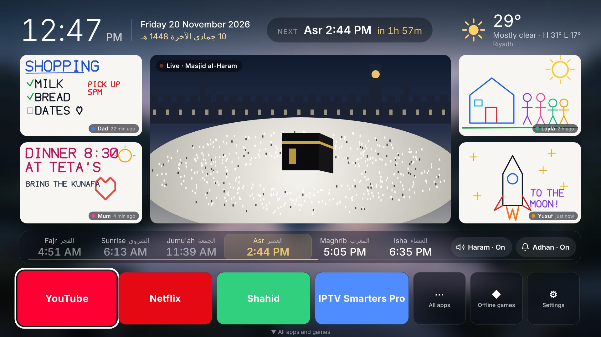

| | |
|---|---|
| 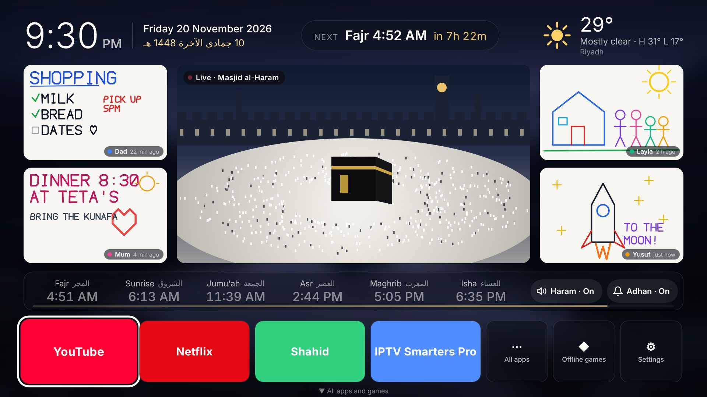 | 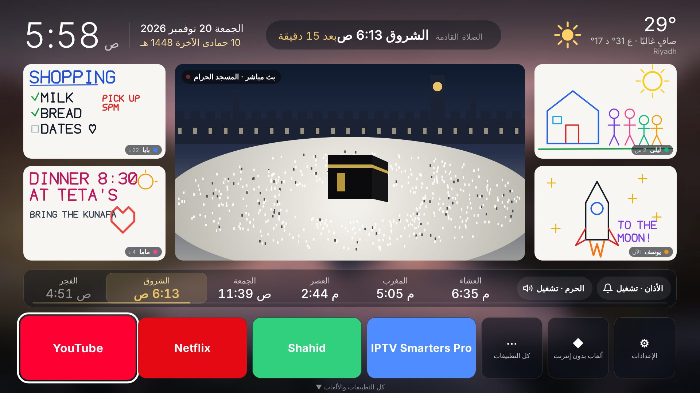 |
| 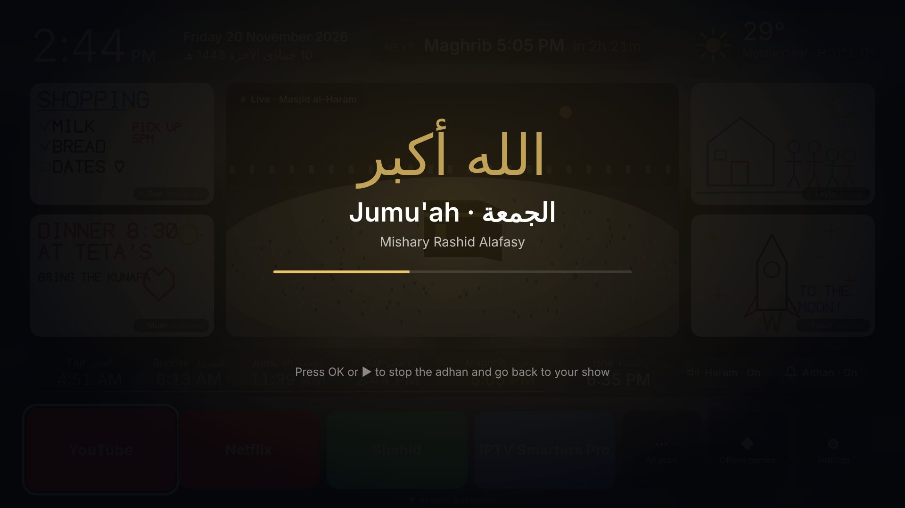 | 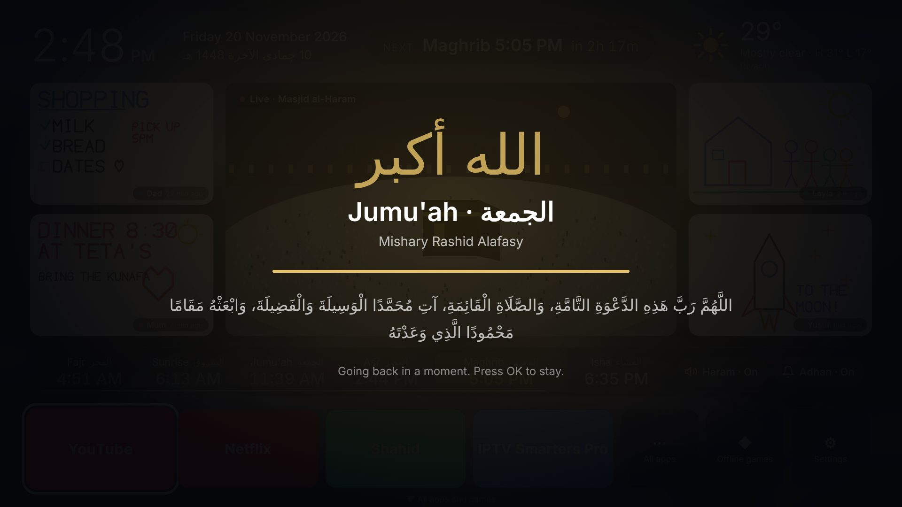 |
| 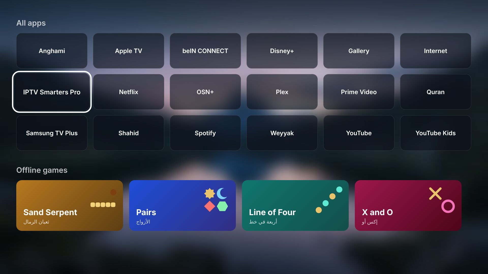 | 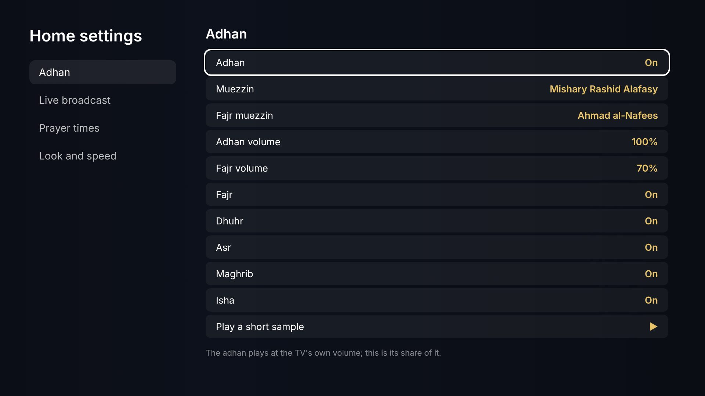 |
| 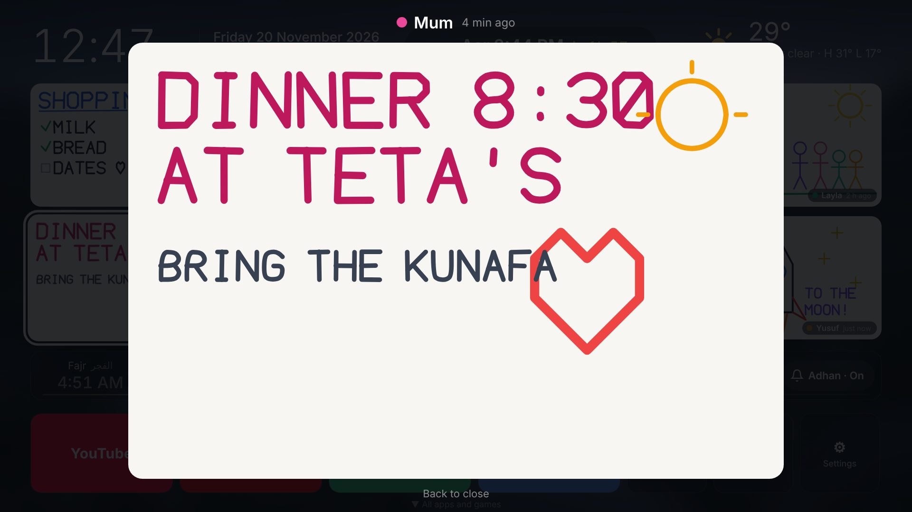 | 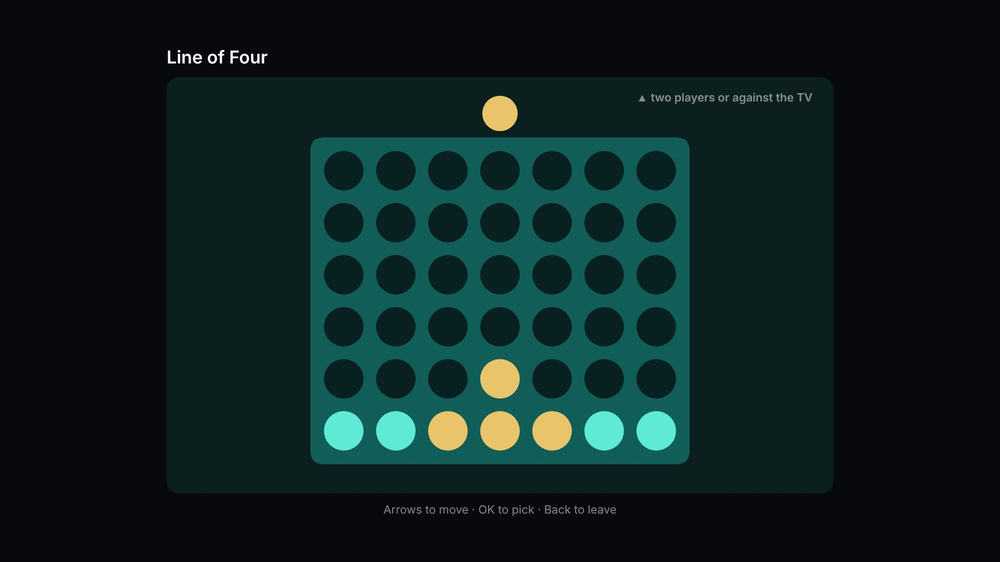 |

The phone side (relay/public), and the TV a moment later, drawn through the relay on this computer:

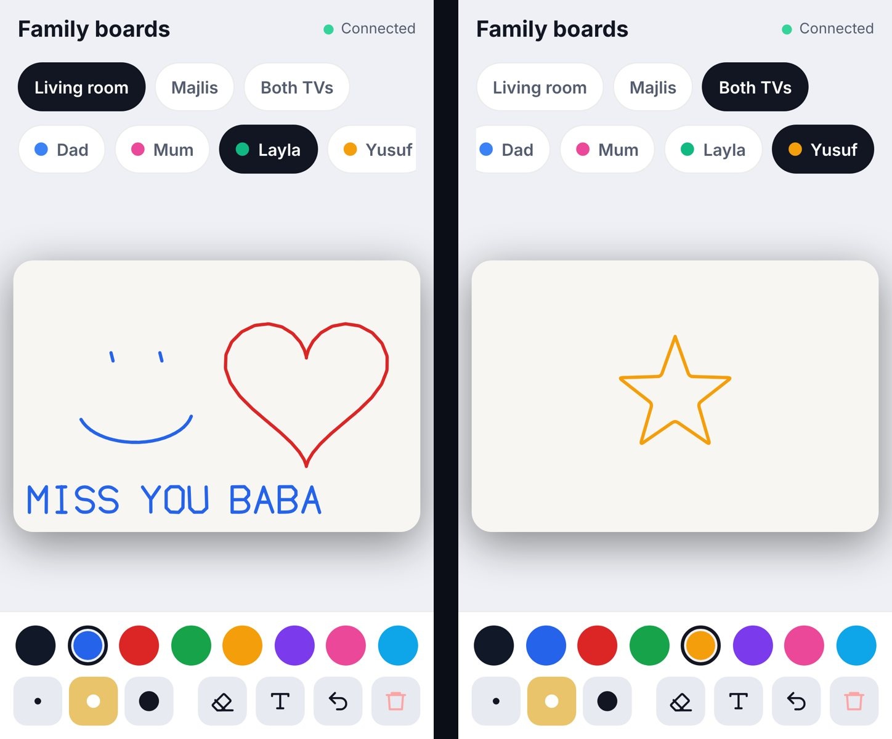
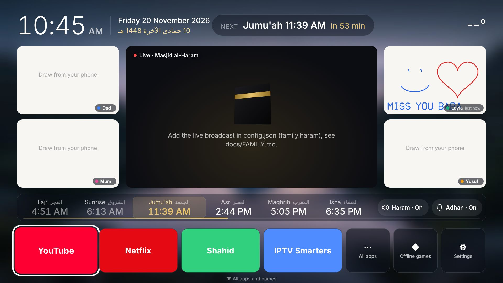

The pictures are `tv-home/web/family.html?demo=1` in a browser with made-up data. The live tile there is
a drawing, not a photograph or a broadcast. Nothing here has run on a real Samsung or LG yet: see
"Tested so far".

## What does not work, or works differently (read this first)

- **It is an app that opens itself, not a true home screen.** Samsung and LG let no app replace their home
  ([SAMSUNG.md](SAMSUNG.md), [LG.md](LG.md)). With the bridge (a computer at home that stays on) it opens
  when the TV comes on; the remote's Home button still opens Samsung's or LG's own home.
- **The Samsung cannot pass its satellite picture to the LG.** The tuner draws on its own video plane,
  which no app can read, and Samsung gives no way to stream live TV out of the TV. To show the satellite on
  the LG without using the internet, give a computer at home its own satellite tuner (below, "The LG and
  the satellite"); otherwise the LG uses an internet stream, with the data saver.
- **On the Samsung the tile shows whatever channel the tuner is on.** Samsung withdrew the channel API from
  apps in April 2024 and keeps channel changes for its partners, so the app cannot pick the channel. With
  `tuner_channel` set, the bridge types the channel number on the remote once after the TV comes on (about
  six seconds of Samsung's own TV screen, then the home again). Untested on a real TV.
- **"Haram sound off" on the Samsung mutes the whole TV while the home is on screen.** Samsung offers no way
  to quieten only the tuner's window (its mute call, which Samsung marks old since 2020, mutes everything).
  It is undone the moment anything else opens, and while the adhan plays. On the LG it mutes only the stream.
- **The adhan over Netflix, YouTube, Shahid and the rest needs the bridge.** Neither TV lets an app play
  sound or draw over another app, and couch-tv's page is frozen while another app is in front. So the bridge
  presses Pause, brings the home forward, and the home plays the adhan; OK or Play stops it and the bridge
  opens the show again and presses Play; when the adhan ends by itself the show comes back paused. Live TV
  and HDMI inputs cannot be paused: the home still comes forward over them (`adhan.never` lists anything it
  must leave alone). Without a bridge the adhan plays only while the home is on screen.
- **Drawing from outside the home needs the relay**, a small free Cloudflare service you put up once
  ([relay/README.md](../relay/README.md)). Anyone with the family link can draw on the boards (nothing else:
  the relay cannot touch the TVs, it only carries drawings). Change `DRAW_KEY` to shut out an old link.
- **The adhan recordings are not in this repository** (they are not ours to give away).
  `scripts/get-adhan.py` downloads the ones you choose, for your own use. None of them has a separate Fajr
  recording with "as-salatu khayrun min an-nawm": add your own with `--add ... --fajr ...`.
- **YouTube as the live source may not play** inside a packaged TV app (YouTube's error 153, "missing
  referrer"). Through the bridge it is wrapped in a page with a normal address, which should avoid that.
  YouTube picks the picture size itself, so its data use cannot be capped. An HLS address is better.
- **Prayer times** are worked out on the TV and the bridge with the standard formulas and each authority's
  angles. Against AlAdhan's own published times (15 cities, 20 Nov 2026) Fajr, sunrise, Dhuhr, Maghrib and
  Isha agree to the minute and Asr to within two minutes. Check them once against your mosque and use
  `prayer.offsets` (minutes per prayer) if it differs.

## Setting it up

You need what a Samsung or LG already needs for couch-tv ([SAMSUNG.md](SAMSUNG.md), [LG.md](LG.md)), with
the bridge running (option B) for the adhan over other apps and for opening at switch-on.

1. **The relay** for the whiteboards: [relay/README.md](../relay/README.md). It gives you a relay address,
   a household id, a TV key (for config.json) and the family link (for the phones only).
2. **config.json**: add a `family` section. [examples/family.config.json](../examples/family.config.json)
   is a whole example for one Samsung with a dish and one LG. The bridge checks it at start and stops with a
   plain message if something is wrong.
3. **The adhan recordings**: `python3 scripts/get-adhan.py` (all), or `--only alafasy,nafees`. It levels
   them to the loudness TV programmes are made to (-23 LUFS) when ffmpeg is on the computer.
4. **The live picture** for each TV (next section).
5. **Build and install the app** the usual way: `samsung/build.py --bridge ... --tv living` and
   `lg/build.py --bridge ... --tv majlis`, then install as in SAMSUNG.md and LG.md. With a `family` section
   the app opens the family home; Home settings, Look and speed, "Open the classic couch-tv home" opens the
   usual one.
6. **Each phone**: open the family link, then Add to Home Screen. Pick the TV (or Both TVs) and your name.

## The live picture

Set per TV in `tvs[].family.haram` (or for both in `family.haram`). `source` is `auto` unless you set it.

| Source | Setting | Internet used |
|---|---|---|
| The Samsung's own satellite tuner | `"samsung_tuner": true`, and `"tuner_channel": "105"` (your TV's number for the Quran channel) | None |
| A computer at home with a satellite tuner (for the LG) | `"dish_url": "http://<bridge>:5400/tv/family/live/index.m3u8"` | None |
| An HLS address you are allowed to use | `"stream_url": "https://..."` | Only while the home is on screen; see below |
| YouTube | `"youtube": "<11 character video id>"` | YouTube decides |

**The LG and the satellite.** One dish can feed both: a USB DVB-S2 tuner (or a SAT>IP box) on the bridge
computer, on a second LNB output or a splitter, with TVHeadend, then
`scripts/haram-lan-stream.sh <TVHeadend's address for the Quran channel>`. It writes a rolling HLS stream
the bridge serves to the LG. `copy` passes an H.264 channel through almost free; `small` re-encodes an SD
channel to 360p.

**Data saver (internet streams).** The smallest picture of at least 360 lines is picked from the stream's
playlist (the tile is 960 pixels wide), it plays only while the home is on screen, and it stops after
`data_saver_minutes` (20) without a key press; OK on the tile starts it again. A 360p stream is typically
0.4 to 0.9 Mbit/s, so about 180 to 400 MB for each hour the home is actually on screen.

## Using it

- **Arrows and OK.** The whiteboards, the live picture, the two switches (Haram sound, Adhan) and the app row
  are all reachable. OK on a board shows it big; OK on the live picture shows it full screen; Back returns.
- **Down from the app row**: every app on the TV, then the offline games. Up or Back returns.
- **The adhan**: OK or Play stops it (and takes you back to your show, playing, if it paused one); Back stops
  it and stays on the home. After it ends, the dua after the adhan shows for 25 seconds.
- **Settings** (the gear tile): muezzin, a different muezzin for Fajr, the adhan's share of the TV's volume
  (a gentler Fajr), each prayer on or off, a short sample, the live picture's sound and data saver, the
  calculation method and Asr, the Hijri date by a day either way, the background, speed and language. What
  is changed there stays on that TV and wins over config.json.
- **The phone**: pick a TV (or Both TVs) and whose board, then draw. Colours, three sizes, eraser, Undo,
  Clear (it asks first), and "Type a note", which writes typed words onto the board as handwriting.

## Speed

Made for slow TV chips: only transform and opacity animate; nothing is blurred on the TV (the five
background pictures, 240 KB in all, are blurred once by `scripts/make-family-bg.py`); the clock touches the
page once a minute; a whiteboard draws only the new piece of a stroke as it arrives; a game draws only when
something changes (Sand Serpent moves by itself). On a TV that cannot keep up (under about 35 frames a second
in the first three seconds) it switches to Lite by itself: no ambient motion, shorter slides. Home settings,
Look and speed, overrides it.

## Settings in config.json

| Key | |
|---|---|
| `members` | 1 to 4 people: `id` (letters, digits, - or _), `name`, `color` (#rrggbb) |
| `language` | `en` or `ar`; left out, the home's language |
| `relay` | `url`, `household`, `tv_key`. Never the draw key |
| `prayer` | `method` (`auto` picks by `country`, or MWL, ISNA, EGYPT, MAKKAH, KARACHI, TEHRAN, GULF, KUWAIT, QATAR, SINGAPORE, FRANCE, TURKEY, RUSSIA, DUBAI, JAKIM, TUNISIA, ALGERIA, KEMENAG, MOROCCO, PORTUGAL, JORDAN), `asr` (`auto`, `standard`, `hanafi`), `high_lat` (`angle`, `middle`, `seventh`, `none`), `hijri_adjust` (-2 to 2), `offsets` (minutes per prayer, -30 to 30) |
| `adhan` | `on`, `muezzin`, `fajr_muezzin`, `volume` and `fajr_volume` (10 to 100, its share of the TV's volume), `prayers` (each on or off), `interrupt_apps`, `never` (package names to leave alone), `dua`, `return_after` |
| `haram` | `source`, `samsung_tuner`, `tuner_channel`, `dish_url`, `stream_url`, `youtube`, `data_saver_minutes` (0 = never stop), `muted` |
| `apps` | up to four for the row, matched by name on each TV (`youtube`, `netflix`, `shahid`, `smarters`, or any app's name) |
| `background` | `mountain`, `volcano` or `hills`; `scripts/make-family-bg.py --from photo.jpg --name mine` makes your own |
| `speed` | `auto`, `lite` or `full` |

`tvs[].family.haram` overrides `haram` for one TV. The TV key goes to the TV app and the phone remote's
settings on your home network; it can only read the boards.

## Tested so far

In this repository, without a TV: the prayer times against AlAdhan (`tests/test_family_prayer.py`, the
JavaScript and Python versions agreeing exactly); the bridge's settings check and the adhan pausing,
bringing the home forward and going back, with stand-in TVs (`tests/test_family_bridge.py`); the relay
with a TV and two phones, keys, bad input and Both TVs (`tests/test_family_relay.mjs`); a phone page
drawing through the relay onto two TV pages in Chromium; the built Samsung app's page with a stand-in for
Samsung's calls (the tuner window in the tile's place, hidden for the adhan and back after it, Netflix opened
by its Samsung id); the Samsung and LG builds. Not yet: anything on a real Samsung or LG. Please open an
issue with what worked and what did not.

## More ideas

- Pictionary on the boards: one phone draws a word the TV shows only to them, the rest guess.
- Ramadan: suhoor and iftar countdowns in place of the next prayer, and Imsak.
- Friday: a reminder for Surah al-Kahf and the time for Jumu'ah.
- A verse or a hadith of the day under the clock, in Arabic and the home's language.
- An iqama countdown after each adhan, with each mosque's minutes.
- Photos to a board from the phone (shrunk on the phone, stored with the strokes).
- Quiet hours: no adhan over a film after Isha, a gentler Fajr, or the adhan only in some rooms.
